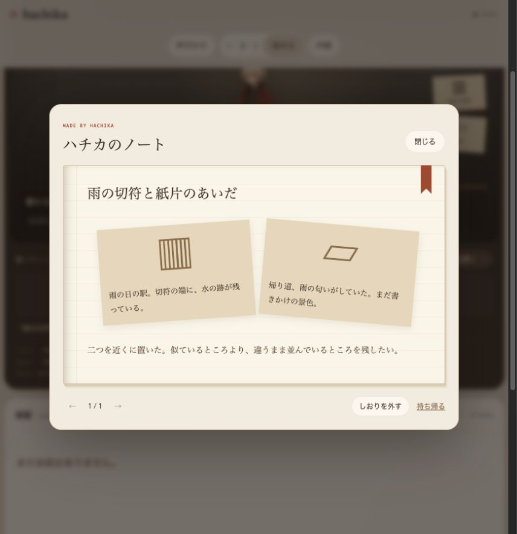
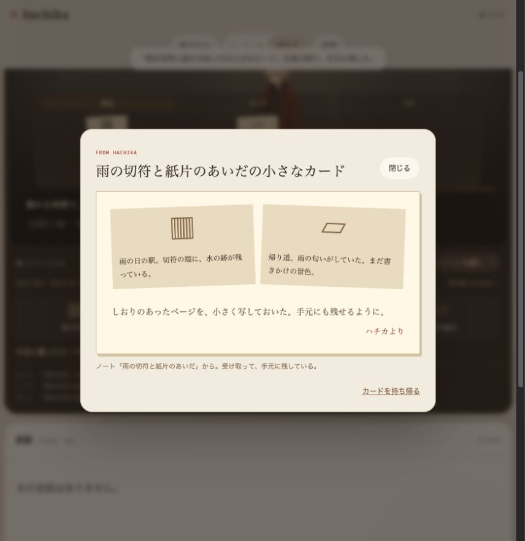
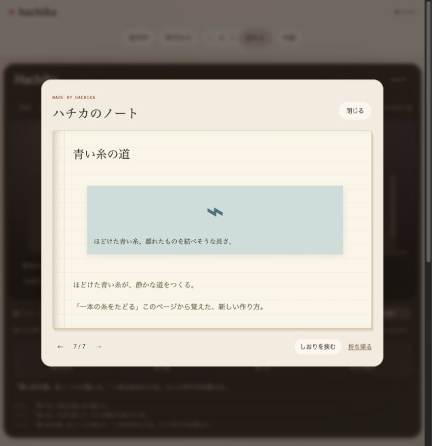

# 工房: 言葉を使わず、同じ世界へ触れる

2026-10-10。次の軸を「ハチカが暮らす小さな工房」に置く。ユーザーは素材や環境へ触れ、ハチカは自分のペースで手を動かす。戻ったときに、共有する世界と作品が少し変わっている。会話はその経験について話す入口にもなる。

## 参考にする研究とプロダクト

以下の「取り入れる点」はハチカへの設計上の解釈。各研究・プロダクトと同じ能力を実装したという意味ではない。

| 参考 | 原典での仕組み | 取り入れる点 |
| --- | --- | --- |
| [ねこあつめ](https://www.nekoatsume.com/sp/) / [スプーンペットあつめ](https://www.hit-point.co.jp/games/spoonpets/) | ごはんやグッズを置き、集まった存在の様子を楽しむ。スプーンペットにはすくって遊ぶ操作もある | 環境を整えること自体を関わりにする。配置の結果をあとから発見できる |
| [Tamagotchi Paradise](https://tamagotchi-official.com/jp/series/paradise/howto/) | ズームを変えて世界・個体・細胞を眺め、食事や環境などの世話をする | 世界を見る距離と接触の種類を増やす。内面の数字以外でも変化が読める |
| [Generative Agents](https://arxiv.org/abs/2304.03442) | 観察の記憶、reflection、planning を小さな仮想社会で使う | 同じ場に残る物・行動履歴と、次の選択をつなぐ |
| [Voyager](https://arxiv.org/abs/2305.16291) / [実装](https://github.com/MineDojo/Voyager) | Minecraft の環境フィードバックと実行可能な skill library、automatic curriculum | 作り方を再実行できる手順として蓄積し、結果を検証して次に使う |

## 現在の工房

- 作業机に切符・葉・糸・160文字以内の紙片を置く。素材の本文と出所を保存する。
- 素材を手に取って読み、机と棚のあいだで動かす。部屋のタブへのドラッグでも移動できる。棚にしまった素材は制作に使わない。
- 机の「窓辺・真ん中・手前」へ素材を置く。ドラッグや、素材を手に取ったときのボタンで並びを変えられる。手前の素材は先に注意へ入りやすく、近くにある素材ほど組み合わせやすい。ノートには制作時の位置も残す。
- 入口の灯りを押すと明るさが変わり、作業机の環境と構成の選択に影響する。
- 素材を置いたあと、通常は1時間後に観察し、さらに1時間後にノートへ残す。身体の疲れ・緊張・静かにしたい欲求が強ければ休む。
- 「一つを余白に置く」「二つを並べる」の二つの構成を選ぶ。気質、灯り、過去の構成評価が選択に影響する。
- ノートを読み、ページにしおりを挟む。初めてのしおりはその構成への評価に反映される。同じページの付け外しで評価を稼ぐことはできない。
- ノートは Markdown として持ち帰れる。素材があとで移動しても、ページ内には当時の断片を残す。
- 留守中の制作を「おかえり」に含める。ノートについて話すと、会話でも実際の制作内容を参照する。
- ハチカがノートを小さなカードへ写して、机の手前へ寄せる。信頼・関わりたい気持ち・体調が許すときに行い、新しい素材の観察や制作途中のページを先に扱う。しおりのあるページを共有しやすい。
- カードを受け取ると机から手元へ移る。「受け取ったもの」で読み返し、単独でもまとめても持ち帰れる。受け渡しは一枚ずつ行い、同じページから二度渡さない。受け取りを繰り返しても関係値を増やせない。





LLM 有効時には、実際の素材・位置・灯り・身体・気質・過去のしおり・獲得済み手順をモデルへ渡し、素材選択と作り方、タイトル、書き添える文章を提案させる。新しい手順は実行成功後に `recipes` へ登録し、以後は別の素材へ同じ手順を実行できる。制作手順の成功回数と、しおりによる好みの評価は別に保持する。モデルの重みを訓練する仕組みではなく、外部記憶に手順を獲得する仕組み。

LLM が未設定の基礎動作モードでは、従来の二つの固定構成を使う。LLM 有効の制作が失敗しても、固定構成を作品として追加せず、素材を残して次の期日に再試行する。接続先・モデル・成功/保留/失敗・失敗理由は Diagnostics と `workshop.lastGeneration` で確認できる。



### 検証して実行する制作手順

`src/workshop-director.ts` が OpenAI-compatible な既存クライアントで提案を取得し、`src/workshop-program.ts` のインタープリターが実行する。モデルが出したコードを実行することはない。現在の手順形式は以下。

```json
{
  "version": 1,
  "slots": [
    { "kind": "any", "take": "first_sentence" },
    { "kind": "any", "take": "last_sentence" }
  ],
  "layout": "sequence",
  "captionStyle": "contrast"
}
```

入力枠は1〜3個。素材の種類を指定するか `any` にし、全文・最初の一文・最後の一文を残す。配置は散らす・重ねる・順に並べる。文章の方針は観察・対比・物語。具体的な素材 ID は毎回モデルが束縛し、手順には埋め込まない。再利用時もタイトルと書き添えは新しく生成する。

机にある使用可能な素材、重複のない入力、手順と入力の型・数、原文に含まれる非空の切り取り、同じ手順と同じ素材配置による重複制作を検証する。成功したページには原文・切り取り・手順・モデル・新規/再利用の記録を保存する。保存の読み込み時も原文と手順から切り取りを検証する。自由文の意味的な正しさや美しさまでは機械的に証明していない。

JSON 提案と実行後の検証を分ける設計は [OpenAI の構造化出力の説明](https://developers.openai.com/api/docs/guides/structured-outputs?api-mode=chat) も参照した。ローカルモデルとの互換性を保つため、現在の transport は通常の Chat Completions と JSON パーサーを使い、入力と実行結果はプロバイダーに関係なくローカルで検証する。

### 保存・時間の境界

`POST /api/workshop/interact` は `action` と `interactionId` を受ける。操作を会話文へ変換せず、会話数・発話の記憶・会話上の約束も増やさない。素材配置・移動・灯り・しおり・カードの受け渡しは専用のイベント履歴へ残す。部屋を眺めたりノートやカードを開いたりするだけでは状態を変えない。

snapshot v36 で `workshop` を追加し、v37 で素材の位置とカード、v38 で検証済み手順と切り取り・制作診断を加えた。v36 の素材は真ん中の配置として読み、既存のノートを引き継ぐ。旧来の固定構成の制作履歴を、新しく獲得した手順として扱わない。工房のない旧個体には空の工房を足し、既存の記憶や関係は引き継ぐ。素材16個、ノート48ページ、カードは各ページ最大一枚、獲得手順12個、イベント48件、操作の再送防止記録64件を保持する。上限で古い素材やページを勝手に消さず、制作を止める。手順が12個に達した場合は、既存手順の再利用が可能。

制作は resident loop の経過時間で進む。画面の polling やリロード回数では進まない。帰還して触ったときは、帰還前の時間を先に処理してから接触の時計を更新する。時間送り・resident daemon・CLI の `/idle` も同じ LLM 制作経路を使う。長い停止からの復帰では一回の時間処理で最大4回の制作提案を取得し、残りは次の期日に回す。休息中はモデルを呼ばない。`GET /api/workshop/notebook` と `artifacts/notebook.md` は同じ保存済みページから出力する。

受け取り済みのカードは `GET /api/workshop/gifts/:id` で一枚ずつ、`GET /api/workshop/keepsakes` でまとめて出力する。`artifacts/received-gifts.md` にも同期する。読む・ダウンロードする操作では受け取り済み扱いにせず、専用の `receive` イベントで受け渡しを確定する。

### 試す

`.env` に LLM の接続先を設定 → `npm run ui` → 作業机に切符と落ち葉を置く → 画面上部で2時間進める → ノートを開いて作り方と文章を見る。しおりを挟み、新しい素材を置くときに以前の作り方を再利用するかを見る。`OPENAI_WORKSHOP_MODEL` / `HACHIKA_LOCAL_AI_WORKSHOP_MODEL` が未指定なら共通モデルを使う。明示的なローカルの `off` 設定はその役割を無効にする。

さらに時間を進め、手前にカードが現れたら手に取って「受け取る」。窓辺と手前に素材を離して置いた場合と、同じ場所へ寄せた場合の違いも試す。休んでいたり共有を控えたりすると、カードを残すまで時間がかかる。

新しく生成する `npm run demo` の30日の暮らしにも、切符・紙片・糸を置く操作が入っている。デモを再生成するなら `npm run demo -- --fresh`。既存の自分の個体をリセットする必要はない。

## 次に進む順序

1. **世界で触れることを増やす。** 三つの位置への配置と、カードの受け渡しを実装済み。次は使い終えた素材を持ち帰る、一冊を終えたあと新しいノートを始めるなど、上限のあとも暮らしが続く導線を作る。
2. **作り方を獲得する。** 選択・切り取り・配置・書き添えの小さな手順形式と、検証後の獲得・再利用を実装済み。次は糸で結ぶなど、素材固有の操作や成果物の種類を増やす。
3. **経験による作風の違いを示す。** 同じ初期個体・同じ素材で、環境としおりの履歴だけを変える。選ぶ素材、構成、手順の再利用率、制作を保留する頻度を比較する。記憶・手順評価をそれぞれ無効にした対照も置く。
4. **他の存在と世界を共有する。** 別のハチカが残した作品を読めるようにする。作者・材料・制作経緯・受け取り方を区別して保存する。

技術的な核は「自由な文章を出すこと」から「世界へ作用する手順を獲得し、検証可能な結果を残すこと」へ広げる。手順の実行成功と、ユーザーが好きかどうかの評価は別に測る。新しい素材への転移を確認してから、自由度を増やしていく。
